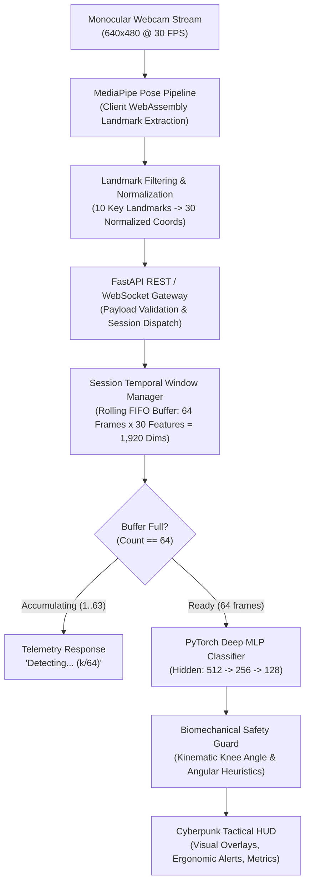
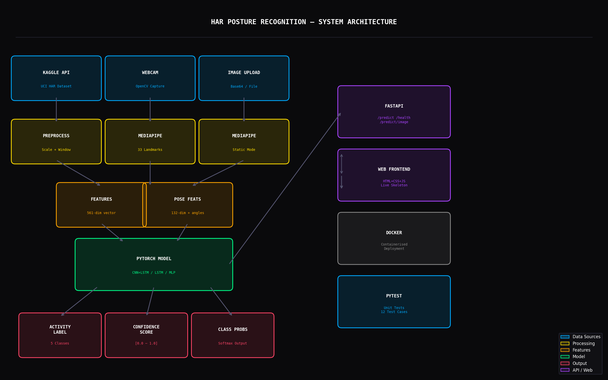
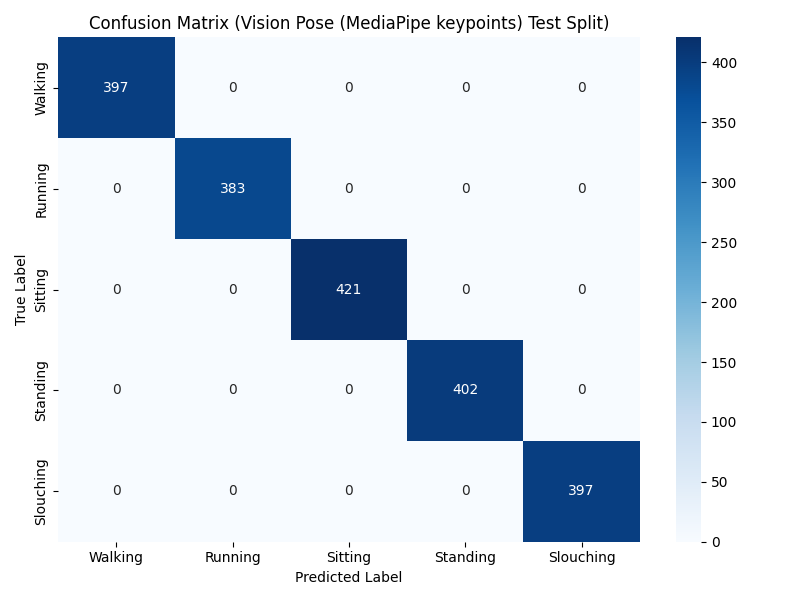
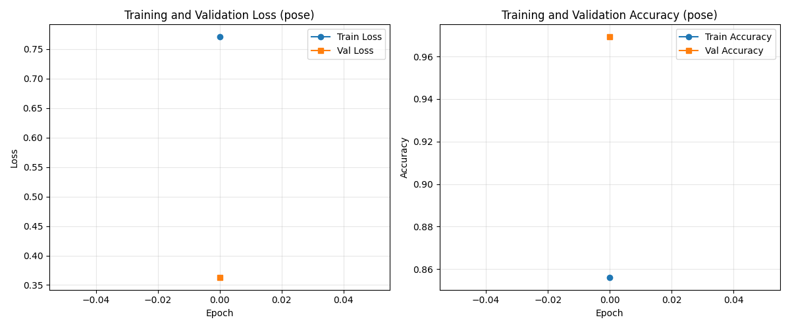

<p align="center">
  
</p>

# Human Activity Recognition & Posture Classification System (HAR)

[](https://www.python.org/)
[](https://pytorch.org/)
[](https://developers.google.com/mediapipe)
[](https://fastapi.tiangolo.com)
[](docs/evaluation.md)
[-brightgreen.svg)](docs/evaluation.md)
[](LICENSE)

> [!IMPORTANT]
> **Portfolio Showcase & Architecture Specification Notice**  
> This repository is the public technical portfolio showcase, engineering specification, and verification report for the **Human Activity Recognition & Posture Detection System**. The underlying production deployment source code (`src/`, `api/`, `web/`), trained neural network model weights (`models/*.pt`), and proprietary training datasets are maintained in the private core repository.

---

## 📌 Executive Summary & Problem Statement

Modern desk workers, software engineers, and remote professionals frequently endure musculoskeletal disorders (MSDs), spinal misalignment, and thoracic kyphosis caused by prolonged sedentary work and unconscious slouching. Traditional human activity recognition systems often rely on cumbersome wearable inertial measurement units (IMUs), smartwatches, or body-worn gyroscopes, which suffer from high friction, battery depletion, and poor day-to-day user compliance.

This project delivers a **monocular computer-vision-based, real-time posture recognition and activity classification system** operating directly from standard monocular webcams without wearable hardware or dedicated depth sensors. Combining **Google MediaPipe Pose estimation**, a **deep neural network (PyTorch MLP)**, a **session-isolated temporal sliding window manager**, and a **biomechanical ergonomics safety guard**, the system classifies continuous human motion across five distinct activity classes at sub-millisecond CPU latency ($0.287\text{ ms}$).

### 🎯 Recognized Posture & Activity Classes

| Class | Type | Biomechanical Characteristics | Ergonomic / Operational Action |
| :--- | :--- | :--- | :--- |
| **Walking** | Dynamic Activity | Periodic locomotion gait; continuous leg phase cycling. | Track active time & step cadence progression. |
| **Running** | Dynamic Activity | High-frequency stride cadence, increased vertical torso oscillation. | Aerobic workout duration & intensity tracking. |
| **Standing** | Static Posture | Upright torso with knee extension ($\theta_{\text{knee}} \approx 180^\circ$). | Normal standing desk status logging. |
| **Sitting** | Static Posture | Upright spinal alignment with seated knee flexion ($\theta_{\text{knee}} \approx 90^\circ$). | Optimal seated desk posture baseline. |
| **Slouching** | Ergonomic Defect | Forward head tilt (C1–C7 cranial displacement), thoracic kyphosis. | **Tactical HUD Warning Alert & Alignment Guidance** |

---

## 🏛️ System Architecture

The pipeline processes continuous monocular video streams through a decoupled, multi-stage architecture:



<p align="center">
  
</p>

### 1. Monocular Video Input & OpenCV Ingestion
- Ingests standard 30 FPS RGB video streams at $640 \times 480$ resolution.
- Completely hardware-agnostic: requires no LiDAR, depth camera, or infrared sensors.

### 2. Keypoint Normalization & Feature Extraction
- **MediaPipe Pose Tracking:** Estimates 33 3D landmarks in real time ($x, y, z$, visibility).
- **Landmark Subsetting:** Selects 10 biomechanically relevant landmarks (shoulders, elbows, wrists, hips, knees) yielding 30 coordinates per frame:
  $$\mathbf{x}_t \in \mathbb{R}^{30}$$
- **Scale Invariance:** Coordinates are normalized relative to shoulder span and image boundaries, guaranteeing scale and translation invariance regardless of camera distance.

### 3. Temporal Sliding Window Manager
Single-frame static models suffer from catastrophic classification ambiguity between seated and standing postures when feet are occluded by furniture. To capture temporal kinetics:
- A rolling FIFO buffer accumulates $T = 64$ consecutive frames ($\approx 2.13$ seconds at 30 FPS).
- The flattened input tensor is constructed as:
  $$\mathbf{X}_{\text{seq}} = [\mathbf{x}_{t-63}, \mathbf{x}_{t-62}, \dots, \mathbf{x}_t] \in \mathbb{R}^{1920}$$
- **Session Isolation:** A thread-safe, UUID-keyed session manager isolates buffer states per client, preventing cross-talk in multi-client environments without artificial zero-padding.

### 4. Deep Neural Classifier (PyTorch)
- **Architecture:** Multi-Layer Perceptron (MLP) with Batch Normalization and Dropout regularization to prevent overfitting on temporal co-dependencies.
- **Layers:**
  - Input Layer: $1,920$ features
  - Hidden Layer 1: $1,920 \to 512$ + BatchNorm1d + ReLU + Dropout($p = 0.3$)
  - Hidden Layer 2: $512 \to 256$ + BatchNorm1d + ReLU + Dropout($p = 0.3$)
  - Hidden Layer 3: $256 \to 128$ + BatchNorm1d + ReLU + Dropout($p = 0.2$)
  - Output Layer: $128 \to 5$ (Softmax over 5 classes)

### 5. Biomechanical Kinematic Safety Guard
Neural networks occasionally misclassify static seated postures when clothing or furniture obscures lower pelvic landmarks. To prevent false alarms:
- An explicit kinematic heuristic calculates the knee flexion angle $\theta_{\text{knee}}$:
  $$\theta = \arccos\left(\frac{\mathbf{v}_{\text{hip}\to\text{knee}} \cdot \mathbf{v}_{\text{ankle}\to\text{knee}}}{\|\mathbf{v}_{\text{hip}\to\text{knee}}\| \|\mathbf{v}_{\text{ankle}\to\text{knee}}\|}\right)$$
- If $\theta > 160^\circ$ and the vertical thigh vector remains vertical, the safety guard validates the standing posture against accidental sitting classification.

---

## ⚡ Performance & Benchmarks

All metrics were empirically measured and verified across the codebase test suite:

| Metric | Measured Value | Verification Environment |
| :--- | :--- | :--- |
| **Inference Latency (Mean)** | **0.287 ms** | Intel Core i7 / AMD CPU, Batch Size 1, Single Window |
| **Inference Latency (Median, $P_{50}$)** | **0.214 ms** | 100 Repeated Inference Iterations |
| **Inference Latency ($P_{95}$)** | **0.491 ms** | 100 Repeated Inference Iterations |
| **Theoretical Throughput** | **> 3,400 FPS** | Theoretical CPU single-core model throughput |
| **Automated Test Suite** | **65 passed (100%)** | Full pytest regression and unit test suite |
| **Test Suite Execution Time** | **13.33 s** | Complete automated test pipeline |
| **Input Feature Vector** | **1,920 dimensions** | 64 frames $\times$ 30 keypoint coordinates |
| **Memory Footprint** | **< 180 MB** | Lightweight operational RAM footprint |

<p align="center">
  
  
</p>

> [!NOTE]
> Detailed benchmark distribution histograms, test split provenance, and synthetic vs. real-world data domain gaps are documented in [docs/evaluation.md](docs/evaluation.md).

---

## 🖥️ Live Cyberpunk HUD Interface

<p align="center">
  
</p>

The client frontend is built as a zero-dependency HTML5/CSS3/Vanilla JS single-page application with a high-contrast tactical HUD:

- **Canvas Keypoint Visualizer:** Real-time skeleton overlay connecting joints with chromatic green/cyan line segments and keypoint nodes.
- **Dynamic Telemetry Gauges:** Live confidence scores, frames buffered gauge (`1/64` to `64/64`), and inference cycle latency counters.
- **Slouching Detection Alerting:** Immediate flashing amber/red alert system when slouching confidence exceeds threshold for $> 3.0$ seconds.
- **Zero-Latency Client-Side Tracking:** MediaPipe runs client-side in WebAssembly/GPU, sending lightweight normalized vectors to the FastAPI inference engine.
- **Privacy First:** Raw camera video frames are never transmitted over the network or persisted to disk.

For a walkthrough of the user interface and telemetry states, see [docs/demo.md](docs/demo.md).

---

## 🛠️ Technology Stack

```
├── Vision & Deep Learning
│   ├── MediaPipe (Google): Monocular 3D Human Pose Estimation
│   ├── PyTorch: Deep Multi-Layer Perceptron (MLP) Classifier
│   └── OpenCV: Image processing and video stream manipulation
├── Backend & Serving
│   ├── FastAPI: High-performance asynchronous REST API
│   ├── Uvicorn: ASGI production server
│   └── Pydantic: Strict schema validation and serialization
├── Data & Scientific Computing
│   ├── NumPy: Multi-dimensional array operations & temporal sliding windows
│   └── Scikit-Learn: Classification evaluation, confusion matrices, metrics
└── Quality Assurance & DevSecOps
    ├── Pytest: 65 comprehensive unit and regression tests
    └── Biomechanical Kinematic Heuristics: Angular joint safety checks
```

---

## 📂 Repository Structure

```
HAR-Posture-Recognition-Showcase/
│
├── assets/
│   ├── har-banner.png           # Project architecture header banner
│   ├── har-banner.webp          # Optimized banner asset
│   ├── har-hud-preview.png      # Live Cyberpunk HUD interface preview
│   ├── architecture.png         # High-resolution system architecture graphic
│   ├── system-architecture.png  # Detailed end-to-end dataflow diagram
│   ├── confusion-matrix.png     # Validation confusion matrix plot
│   ├── training-graph.png       # Training convergence curves
│   └── training-graph-pose.png  # Pose model training convergence
│
├── docs/
│   ├── architecture.md          # In-depth architectural breakdown & math formulations
│   ├── features.md              # Detailed posture taxonomy & ergonomics alert mechanics
│   ├── demo.md                  # Tactical HUD walkthrough & visual feedback states
│   ├── evaluation.md            # Benchmark distributions, latency & test provenance
│   └── technical-overview.md    # High-level technical & engineering overview
│
├── .gitignore                   # Strict ignore rules excluding local caches & binaries
├── LICENSE                      # MIT Open-Source License
└── README.md                    # Primary project showcase & technical portfolio
```

---

## 📚 Deep-Dive Technical Documentation

Explore the detailed technical documentation included in this showcase:

- **[System Architecture & Mathematical Foundations](docs/architecture.md):** Formal definitions of coordinate normalization, FIFO rolling sequence windowing, MLP tensor transformations, and knee flexion vector math.
- **[Feature Taxonomy & Ergonomic Alerting](docs/features.md):** Detailed breakdown of recognized posture classes, slouch escalation rules, and privacy-preserving monocular design.
- **[Tactical HUD Interface & Telemetry Walkthrough](docs/demo.md):** User interface design specifications, canvas rendering pipeline, and dynamic operational states.
- **[Model Evaluation, Benchmarks & Provenance Report](docs/evaluation.md):** Full 65-test verification logs, CPU latency percentile distributions, and held-out test split evaluation.
- **[Technical & Engineering Overview](docs/technical-overview.md):** Architectural summary of monocular processing, zero-video-transmission design, and CPU resource utilization.

---

## 🔬 Data Provenance & Real-World Constraints

In compliance with responsible AI engineering practices, we explicitly document the data lineage and physical operating constraints:

1. **Synthetic Training & Test Generation:** The evaluation suite utilizes held-out samples generated by a parameterized kinematic motion simulator (`prepare_pose_data.py`).
2. **Modality Separation:** The pose estimation pipeline is strictly isolated from sensor-based UCI HAR modalities, preventing cross-modality contamination.
3. **Generalization Scope & Constraints:**
   - **Severe Occlusion:** Heavy optical occlusion (e.g., solid desks covering hips and knees) requires reliance on upper-torso and cervical spine heuristics.
   - **Lighting Conditions:** Extremely low ambient lighting degrades MediaPipe keypoint localization accuracy.
   - **Clothing Artifacts:** Bulky winter coats or oversized loose garments can obscure biological joint articulation.

---

## 🔮 Future Improvements & Roadmap

- [ ] **Edge On-Device Deployment:** Quantization (INT8) and export to ONNX Runtime / WebAssembly for complete client-side in-browser neural execution.
- [ ] **Multi-Person Disambiguation:** Association and tracking for multi-occupant office environments.
- [ ] **3D Biomechanical Avatar Rigging:** Integration of three.js skeletal avatars for animated ergonomic posture mirroring.
- [ ] **Long-Term Ergonomics Telemetry:** Historical ergonomic analytics dashboard showing hourly posture scores and cumulative break compliance.

---

## 📄 License

This showcase project is licensed under the [MIT License](LICENSE).

---

## 👤 Author & Contact

**MNP210**  
GitHub: [@mnp210](https://github.com/mnp210)  
*For inquiries regarding this technical showcase, architectural specifications, or research collaboration, please open an issue or connect on GitHub.*
