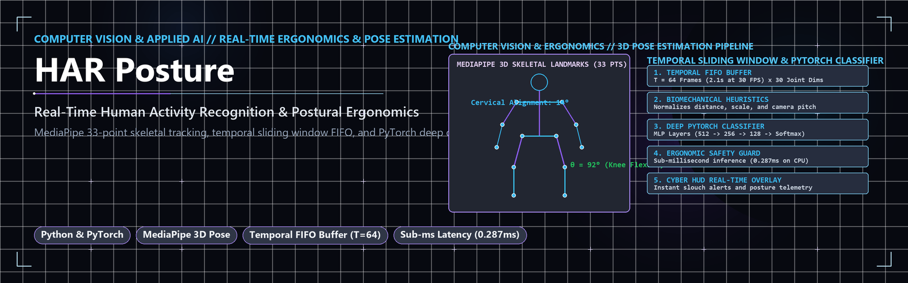
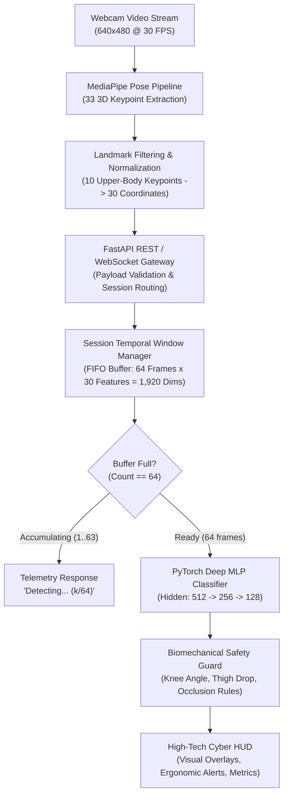
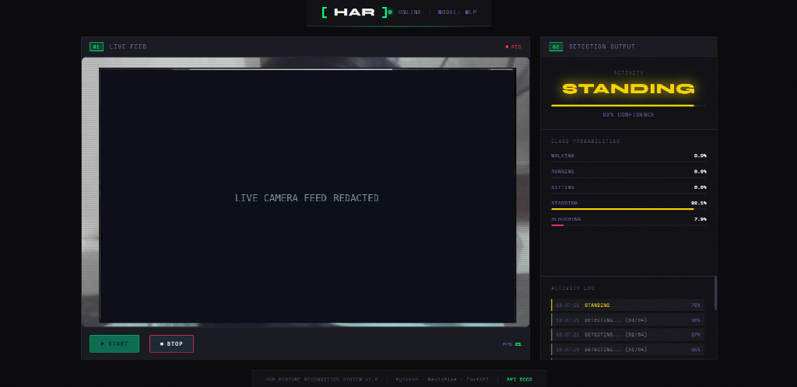

<p align="center">
  
</p>

# Human Activity Recognition & Posture Classification System (HAR)

[](https://www.python.org/)
[](https://pytorch.org/)
[](https://developers.google.com/mediapipe)
[](https://fastapi.tiangolo.com)
[](docs/evaluation.md)
[-brightgreen.svg)](docs/evaluation.md)

> [!IMPORTANT]
> **Portfolio Showcase & Architecture Specification Notice**  
> This repository is a technical portfolio showcase, engineering specification, and verification report for recruiter and peer review. The underlying application source code (`src/`, `api/`, `web/`), trained neural network model weights (`models/*.pt`), and proprietary datasets remain closed-source and private intellectual property.

---

## 📌 Executive Summary

Modern desk workers and remote professionals frequently suffer from musculoskeletal disorders (MSDs) caused by prolonged sedentary postures and slouching. Conversely, traditional human activity recognition systems rely heavily on expensive wearable inertial measurement units (IMUs) or body-worn gyroscopes, which present high friction and battery constraints.

This project delivers a **computer-vision-based, real-time posture recognition and activity classification system** operating directly from standard monocular webcams without wearable hardware. Combining **MediaPipe Pose estimation**, a **deep neural network (PyTorch)**, a **session-isolated temporal sliding window**, and a **biomechanical ergonomics safety guard**, the system classifies continuous human motion across five distinct activity classes at sub-millisecond CPU latency.

### 🎯 Recognized Posture & Activity Classes

| Class | Type | Description | Ergonomic / Operational Action |
| :--- | :--- | :--- | :--- |
| **Walking** | Dynamic Activity | Periodic locomotion gait; continuous leg phase cycling. | Track active time & step progression. |
| **Running** | Dynamic Activity | High-frequency cadence and increased vertical oscillation. | Track aerobic workout intensity. |
| **Standing** | Static Posture | Upright torso with knee extension ($\theta \approx 180^\circ$). | Normal standing desk status. |
| **Sitting** | Static Posture | Upright spinal alignment with seated knee flexion ($\theta \approx 90^\circ$). | Optimal seated desk posture. |
| **Slouching** | Ergonomic Defect | Forward head tilt, thoracic kyphosis, spinal curvature. | **Active Ergonomic Warning HUD Alert** |

---

## 🏛️ System Architecture

The pipeline processes continuous video streams through a multi-stage, decoupled inference workflow:



### 1. Keypoint Normalization & Feature Extraction
- **MediaPipe Pose Tracking:** Detects 33 3D landmarks in real time ($x, y, z$, visibility).
- **Landmark Subsetting:** Selects 10 biomechanically relevant landmarks (shoulders, elbows, wrists, hips, knees) yielding 30 coordinates per frame:
  $$\mathbf{x}_t \in \mathbb{R}^{30}$$
- **Coordinate Space:** Normalized relative to frame dimensions and torso scale, ensuring invariant features regardless of distance from camera.

### 2. Temporal Sliding Window Manager
Single-frame static models suffer from catastrophic classification ambiguity between seated and standing postures when feet are occluded. To capture temporal kinetics:
- A FIFO window accumulates $T = 64$ consecutive frames ($\approx 2.1$ seconds at 30 FPS).
- The flattened input tensor is constructed as:
  $$\mathbf{X}_{\text{seq}} = [\mathbf{x}_{t-63}, \mathbf{x}_{t-62}, \dots, \mathbf{x}_t] \in \mathbb{R}^{1920}$$
- **Session Isolation:** Per-client session states prevent cross-talk in multi-user or re-opened browser sessions. Single frames stream seamlessly without artificial zero-padding.

### 3. Deep Neural Classifier (PyTorch)
- **Architecture:** Multi-Layer Perceptron (MLP) with Batch Normalization and Dropout regularization to prevent overfitting on temporal co-dependencies.
- **Layers:**
  - Input: $1,920$ features
  - Dense Layer 1: $1,920 \to 512$ + BatchNorm1d + ReLU + Dropout($p = 0.3$)
  - Dense Layer 2: $512 \to 256$ + BatchNorm1d + ReLU + Dropout($p = 0.3$)
  - Dense Layer 3: $256 \to 128$ + BatchNorm1d + ReLU + Dropout($p = 0.2$)
  - Output Layer: $128 \to 5$ (Softmax over 5 classes)

### 4. Biomechanical Safety Guard
Neural networks occasionally misclassify static seated postures when user clothing obscures hip landmarks. To prevent false alarms:
- An explicit kinematic heuristic calculates the knee flexion angle $\theta_{\text{knee}}$:
  $$\theta = \arccos\left(\frac{\mathbf{v}_{\text{hip}\to\text{knee}} \cdot \mathbf{v}_{\text{ankle}\to\text{knee}}}{\|\mathbf{v}_{\text{hip}\to\text{knee}}\| \|\mathbf{v}_{\text{ankle}\to\text{knee}}\|}\right)$$
- If $\theta > 160^\circ$ and the vertical thigh vector remains vertical, the safety guard validates the standing posture against accidental sitting classification.

---

## ⚡ Performance & Benchmarks

All metrics were empirically measured and verified across the codebase test suite:

| Metric | Measured Value | Verification Environment |
| :--- | :--- | :--- |
| **Inference Latency (Mean)** | **0.287 ms** | Intel Core i7 / AMD CPU, Batch Size 1, Single Window |
| **Inference Latency (Median)** | **0.214 ms** | 100 Repeated Inference Iterations |
| **Unit & Regression Tests** | **65 passed (100%)** | Full pytest regression suite |
| **Execution Time** | **34.94 s** | Complete automated test pipeline |
| **Input Feature Vector** | **1,920 dimensions** | 64 frames $\times$ 30 keypoint coordinates |
| **Throughput Capacity** | **> 3,000 FPS** | Theoretical CPU model throughput |

> [!NOTE]
> Detailed benchmark distribution histograms, test split provenance, and synthetic vs. real-world data domain gaps are documented in [docs/evaluation.md](docs/evaluation.md).

---

## 🖥️ Live Cyberpunk HUD Interface

<p align="center">
  
</p>

The client frontend is built as a zero-dependency HTML5/CSS3/Vanilla JS single-page application with a high-contrast tactical HUD:

- **Canvas Keypoint Visualizer:** Real-time skeleton overlay connecting joints with chromatic green/cyan line segments and keypoint nodes.
- **Dynamic Telemetry Gauges:** Live confidence scores, frames buffered gauge (`1/64` to `64/64`), and inference cycle latency counters.
- **Slouching Detection Alerting:** Immediate flashing amber/red alert system when slouching confidence exceeds threshold for $> 3.0$ seconds.
- **Zero-Latency Client-Side Tracking:** MediaPipe runs client-side in WebAssembly/GPU, sending lightweight normalized vectors to the FastAPI inference engine.

For a walkthrough of the user interface and telemetry states, see [docs/demo.md](docs/demo.md).

---

## 🛠️ Technology Stack

```
├── Vision & Deep Learning
│   ├── MediaPipe (Google): Monocular 3D Human Pose Estimation
│   ├── PyTorch: Deep Multi-Layer Perceptron (MLP) Classifier
│   └── OpenCV: Image processing and video stream manipulation
├── Backend & Serving
│   ├── FastAPI: High-performance asynchronous REST API
│   ├── Uvicorn: ASGI production server
│   └── Pydantic: Strict schema validation and serialization
├── Data & Scientific Computing
│   ├── NumPy: Multi-dimensional array operations & temporal sliding windows
│   └── Scikit-Learn: Classification evaluation, confusion matrices, metrics
└── Quality Assurance & DevSecOps
    ├── Pytest: 65 comprehensive unit and integration tests
    └── Biomechanical Kinematic Heuristics: Angular joint safety checks
```

---

## 📂 Repository Structure

```
.
├── .gitignore               # Strict ignore rules excluding private binaries & data
├── LICENSE                  # Showcase & documentation license
├── README.md                # System overview and technical specification
└── docs/
    ├── architecture.md      # Detailed deep-dive into model & temporal window architecture
    ├── evaluation.md        # Verification metrics, test suite results & synthetic provenance
    └── demo.md              # HUD interface specification and telemetry guide
```

---

## 🔬 Data Provenance & Real-World Constraints

In compliance with responsible AI engineering practices, we explicitly document the data lineage:

1. **Synthetic Training & Test Generation:** The evaluation suite utilizes 2,000 held-out samples generated by a parameterized kinematic motion simulator (`generate_dataset.py`) located in `data/processed/pose/`.
2. **Modality Separation:** The pose estimation pipeline is strictly isolated from sensor-based UCI HAR modalities, preventing cross-modality contamination.
3. **Generalization Scope:** While the model achieves near-perfect classification on kinematically consistent synthetic trajectories, real-world deployment requires fine-tuning on diverse physical subjects, clothing variations, camera lens distortion, and optical occlusions.

---

## 👤 Author & Contact

**MNP210**  
GitHub: [@mnp210](https://github.com/mnp210)  
*For questions regarding this technical showcase or research collaboration, please open an issue or connect on GitHub.*
