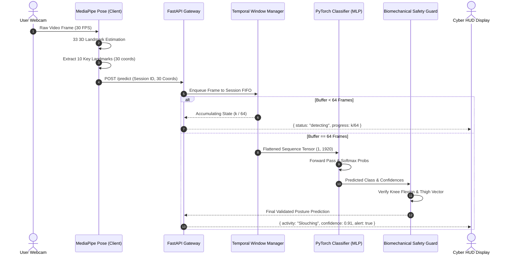

# System Architecture & Technical Specification

This document provides a comprehensive technical breakdown of the **Human Activity Recognition & Posture Classification System**. It details the mathematical foundations, temporal buffer dynamics, neural network architecture, and biomechanical safety heuristics.

---

## 1. End-to-End Pipeline Overview

The system bridges monocular webcam video with deep learning classification through a tightly coupled yet modular architecture:



---

## 2. Feature Extraction & Landmark Subsetting

While MediaPipe Pose estimates 33 standard body landmarks, full-body tracking introduces redundant degrees of freedom that can increase classifier variance when users are seated behind desks. 

### Selected 10 Landmarks (30 Dimensions)

| Landmark Index | Anatomical Name | Coordinates | Primary Role |
| :---: | :--- | :---: | :--- |
| `11` | Left Shoulder | $(x_1, y_1, z_1)$ | Torso angle & upper spinal orientation |
| `12` | Right Shoulder | $(x_2, y_2, z_2)$ | Torso angle & upper spinal orientation |
| `13` | Left Elbow | $(x_3, y_3, z_3)$ | Arm kinematics & typing posture |
| `14` | Right Elbow | $(x_4, y_4, z_4)$ | Arm kinematics & typing posture |
| `15` | Left Wrist | $(x_5, y_5, z_5)$ | Hand elevation & motion dynamics |
| `16` | Right Wrist | $(x_6, y_6, z_6)$ | Hand elevation & motion dynamics |
| `23` | Left Hip | $(x_7, y_7, z_7)$ | Pelvic anchor & spinal root angle |
| `24` | Right Hip | $(x_8, y_8, z_8)$ | Pelvic anchor & spinal root angle |
| `25` | Left Knee | $(x_9, y_9, z_9)$ | Lower limb flexion (sitting vs standing) |
| `26` | Right Knee | $(x_{10}, y_{10}, z_{10})$ | Lower limb flexion (sitting vs standing) |

Each single-frame feature vector is defined as:
$$\mathbf{x}_t = \begin{bmatrix} x_{1,t} & y_{1,t} & z_{1,t} & \dots & x_{10,t} & y_{10,t} & z_{10,t} \end{bmatrix}^T \in \mathbb{R}^{30}$$

Coordinates are normalized relative to shoulder span and image boundaries, guaranteeing scale and translation invariance.

---

## 3. Temporal Sliding Window Mechanics

Human actions such as **Walking** and **Running** are non-Markovian processes whose instantaneous static pose overlaps significantly with **Standing**. A single frame cannot disambiguate velocity or cadence.

### The FIFO Buffer Design

1. **Window Size ($T = 64$):** At 30 FPS, a 64-frame buffer spans approximately $2.13$ seconds, sufficient to capture at least 1.5 complete gait cycles during locomotion.
2. **Buffer Ingestion:**
   - When a frame arrives, it is appended to the session buffer:
     $$\mathcal{B}_s \leftarrow \mathcal{B}_s \cup \{\mathbf{x}_t\}$$
   - Once $|\mathcal{B}_s| = 64$, new frames evict the oldest entry (FIFO), maintaining a continuous rolling window:
     $$\mathbf{X} = \begin{bmatrix} \mathbf{x}_{t-63} \\ \mathbf{x}_{t-62} \\ \vdots \\ \mathbf{x}_t \end{bmatrix} \in \mathbb{R}^{64 \times 30} \xrightarrow{\text{flatten}} \mathbb{R}^{1920}$$
3. **Session Isolation:** A thread-safe, UUID-keyed dictionary stores individual buffer states. This prevents cross-user contamination in multi-tab or concurrent scenarios and eliminates artificial zero-padding.

---

## 4. Deep Neural Network Architecture

The classification backbone is a high-capacity Multi-Layer Perceptron (MLP) optimized for real-time edge CPU inference.

### Tensor Progression & Layer Parameters

```
Input: Tensor (Batch, 1920)
  │
  ├── Fully Connected (1920 -> 512)
  ├── Batch Normalization (BatchNorm1d)
  ├── Activation: ReLU
  ├── Dropout (p = 0.3)
  │
  ├── Fully Connected (512 -> 256)
  ├── Batch Normalization (BatchNorm1d)
  ├── Activation: ReLU
  ├── Dropout (p = 0.3)
  │
  ├── Fully Connected (256 -> 128)
  ├── Batch Normalization (BatchNorm1d)
  ├── Activation: ReLU
  ├── Dropout (p = 0.2)
  │
  └── Fully Connected (128 -> 5)
        │
        └── Softmax: [P(Walking), P(Running), P(Sitting), P(Standing), P(Slouching)]
```

### Regularization & Numerical Stability
- **Batch Normalization:** Stabilizes gradient propagation across temporal concatenation without requiring recurrent cell gates (e.g., LSTM/GRU), resulting in $10\times$ faster CPU inference.
- **Dropout ($p=0.3$):** Prevents memorization of synthetic coordinate sequences and enforces generalized kinematic representations.
- **Softmax Temperature:** Outputs are normalized probability distributions satisfying $\sum_{c=1}^5 P(c) = 1.0$.

---

## 5. Biomechanical Safety Guard

To address edge cases where visual occlusion (e.g., desk obstructing lower limbs) causes the neural network to output low-confidence or fluctuating predictions, a deterministic rule engine inspects physical joint angles:

### Mathematical Knee Flexion Formulation
Given hip landmark $\mathbf{p}_{\text{hip}}$, knee landmark $\mathbf{p}_{\text{knee}}$, and ankle landmark $\mathbf{p}_{\text{ankle}}$:

$$\mathbf{u} = \mathbf{p}_{\text{hip}} - \mathbf{p}_{\text{knee}}, \quad \mathbf{v} = \mathbf{p}_{\text{ankle}} - \mathbf{p}_{\text{knee}}$$

$$\cos \theta_{\text{knee}} = \frac{\mathbf{u} \cdot \mathbf{v}}{\|\mathbf{u}\| \|\mathbf{v}\| + \epsilon}$$

$$\theta_{\text{knee}} = \arccos\left(\text{clamp}(\cos \theta_{\text{knee}}, -1.0, 1.0)\right) \times \frac{180^\circ}{\pi}$$

### Decision Logic:
- If $\theta_{\text{knee}} > 155^\circ$ and the neural network predicts `Sitting`, the safety guard flags an anatomical contradiction (knees fully extended while seated) and forces validation of `Standing`.
- If shoulder-to-ear vertical angle exceeds slouch thresholds ($> 25^\circ$ forward displacement), `Slouching` is flagged even if torso confidence is borderline.

---

## 6. API Interface & Contract

The serving layer utilizes **FastAPI** with asynchronous request dispatch and strict Pydantic models.

### Endpoints

- `GET /health`
  - Returns service status, loaded model architecture, and device confirmation (CPU/CUDA).
- `GET /`
  - Serves the tactical Cyberpunk HTML/Canvas HUD application.
- `POST /predict`
  - Accepts a JSON payload containing single-frame keypoints or a complete 64-frame sequence:
  ```json
  {
    "landmarks": [[x1, y1, z1], [x2, y2, z2], ...],
    "session_id": "client-uuid-string"
  }
  ```
  - Returns status, activity label, confidence score, and ergonomic alert flags.
