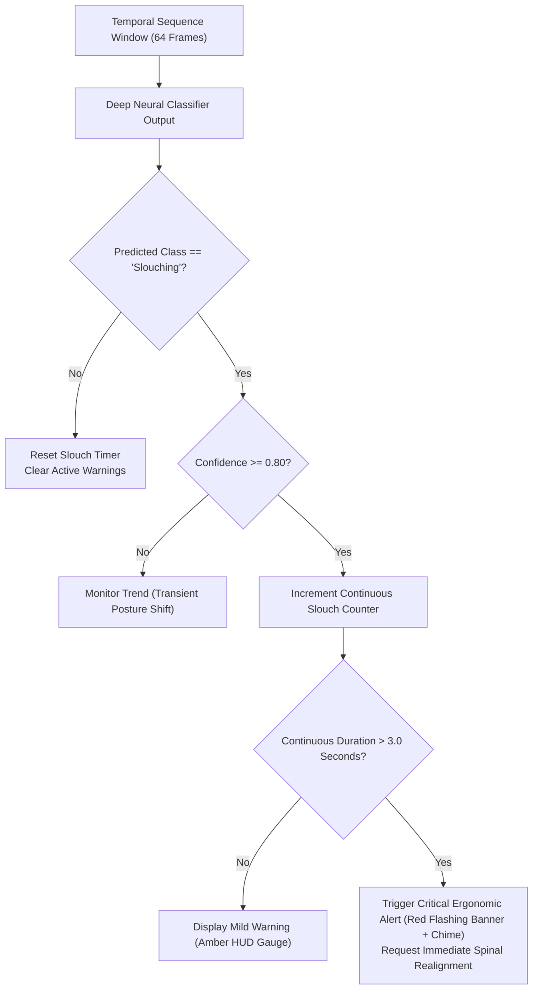

# Features & Posture Classification Taxonomy

This document provides a detailed breakdown of the posture recognition capabilities, activity taxonomy, ergonomic alerting criteria, and telemetry indicators implemented in the **Human Activity Recognition & Posture Classification System (HAR)**.

---

## 🎯 Recognized Activity & Posture Taxonomy

The system classifies human physical states across **5 mutually exclusive classes**, categorized into dynamic locomotive activities, static baseline postures, and ergonomic posture defects:

| Class ID | Class Name | State Type | Biomechanical Profile | Primary Action / Ergonomic Intervention |
| :---: | :--- | :--- | :--- | :--- |
| **0** | **Walking** | Dynamic Locomotion | Alternating leg stance/swing phases; cyclical pelvic translation; arm swing counter-cadence. | Active movement logging; step cadence estimation; posture break acknowledgment. |
| **1** | **Running** | Dynamic Locomotion | Increased vertical torso oscillation; higher stride frequency; extended arm flexion ($> 45^\circ$). | High-intensity cardiovascular activity tracking; workout duration counters. |
| **2** | **Sitting** | Static Posture | Upright spine ($< 15^\circ$ forward lean); horizontal thighs; knee flexion ($\theta_{\text{knee}} \approx 80^\circ - 100^\circ$). | Optimal desk working baseline; sedentary duration timer tracking. |
| **3** | **Standing** | Static Posture | Upright coronal/sagittal spinal alignment; extended lower limbs ($\theta_{\text{knee}} \approx 170^\circ - 180^\circ$). | Active standing desk posture tracking; postural alternation recommendation. |
| **4** | **Slouching** | Ergonomic Defect | Forward head posture (C1–C7 cranial tilt); thoracic kyphosis; rounded shoulders; posterior pelvic tilt. | **Tactical HUD Warning Alert**; audio realignment cue; ergonomics health metric deduction. |

---

## 🛡️ Ergonomic Defect Detection & Alerting Pipeline

Prolonged static slouching is a primary etiology of cervical radiculopathy and upper crossed syndrome among desk workers. The system implements a dedicated ergonomic alerting mechanism:

### Alerting Criteria
1. **Confidence Threshold:** Neural network probability for `Slouching` must exceed $P(\text{Slouching}) \ge 0.80$.
2. **Temporal Persistence Filter:** Single-frame forward dips (e.g., reaching for a pen or keyboard shortcut) are filtered out via the 64-frame sliding FIFO window ($\approx 2.13\text{ seconds}$).
3. **Escalation Protocol:** If poor posture persists for $> 3.0$ seconds continuously, the tactical HUD escalates from amber ambient indicators to high-contrast red tactical warning banners with clear instructions:
   - *"Spinal Curvature Alert: Forward head displacement detected."*
   - *"Please retract chin, pull shoulders back, and straighten thoracic spine."*

---

## ⚡ Real-Time Telemetry & Visual Indicators

The client interface features an industrial cyberpunk tactical HUD designed for real-time cognitive feedback:

### 1. Canvas Skeleton Keypoint Visualizer
- **Tracked Joint Anchors:** 10 core landmarks (shoulders, elbows, wrists, hips, knees) rendered with real-time coordinate tracking.
- **Segmented Limb Vectors:** Color-coded bones connecting joints with hardware-accelerated 2D canvas drawing.
- **Joint Visibility Occlusion Damping:** Dashed translucent segments signal camera obstruction or truncated field-of-view.

### 2. Live Telemetry Readouts
- **Dynamic Posture Label:** Instantly updates as new sliding windows complete inference.
- **Confidence Gauge:** Percentage readout ($0.0\% - 100.0\%$) with high-resolution visual progress bar.
- **FIFO Buffer Accumulation Meter:** Displays real-time frame buffering status (`1/64` to `64/64`) during cold start or subject re-entry.
- **Inference Cycle Latency Monitor:** Sub-millisecond execution time display ($\approx 0.28\text{ ms}$).
- **Session ID Tracker:** Displays active isolated session hash to guarantee multi-client stream separation.

---

## 🔒 Privacy-Preserving Monocular Architecture

Unlike cloud video surveillance or image-upload tools:
- **Zero Raw Video Transmission:** Video frames captured by the monocular webcam are decoded and processed locally on the client machine via MediaPipe's WebAssembly sandbox.
- **Coordinate-Only Transport:** Only normalized, anonymous 3D floating-point vectors ($30$ floats per frame) are sent to the classification engine.
- **No Face Recognition or Biometric Identity Storage:** Landmarks represent anonymous geometric joint positions without facial identifiers or private credentials.
