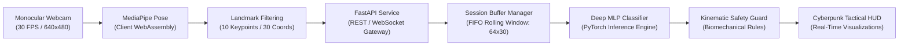

# Technical Overview & Engineering Architecture

This document provides an executive and technical summary of the engineering design, vision processing principles, neural network pipeline, and deployment architecture of the **Human Activity Recognition & Posture Classification System (HAR)**.

---

## 🏛️ System Overview

The system bridges monocular webcam video streaming with deep learning classification through a decoupled, multi-stage processing pipeline:



---

## 🔬 Core Engineering Components

### 1. Monocular Computer Vision Pipeline
- **Hardware Agnostic:** Operates with standard consumer-grade monocular webcams without dedicated depth sensors, stereo rigs, or wearable IMU trackers.
- **Keypoint Extraction:** Leverages Google MediaPipe Pose to estimate 33 3D body keypoints in real time ($x, y, z$, visibility).
- **Subsetting & Normalization:** Selects 10 upper-body landmarks (shoulders, elbows, wrists, hips, knees) yielding a 30-dimensional coordinate vector per frame. Coordinates are torso-scale normalized to ensure invariance against camera distance, lens focal length, and subject stature.

### 2. Temporal Sequence Management
- **The Ambiguity of Instantaneous Poses:** A static single-frame capture of walking or running cannot be disambiguated from standing. Furthermore, desk workers frequently have lower limbs occluded by furniture.
- **Rolling FIFO Buffer ($T = 64$ frames):** Consecutive normalized feature vectors are accumulated in a rolling first-in, first-out buffer spanning $\approx 2.13$ seconds at 30 FPS.
- **Session Isolation:** A thread-safe, UUID-keyed session manager maintains separate temporal buffers per connected client, preventing cross-talk in multi-user setups.

### 3. Neural Network Classifier (PyTorch)
- **Deep MLP Backbone:** A multi-layer perceptron architecture receiving the flattened 1,920-dimensional temporal sequence ($64\text{ frames} \times 30\text{ coordinates}$).
- **Regularization:** Layer-by-layer Batch Normalization (`BatchNorm1d`) and Dropout ($p = 0.3$) stabilize training gradients and prevent co-adaptation of temporal features.
- **Softmax Head:** Yields calibrated posterior probabilities over the 5 target classes:
  $$P(y = c \mid \mathbf{X}) = \frac{\exp(z_c)}{\sum_{j=1}^5 \exp(z_j)}$$

### 4. Biomechanical Kinematic Heuristics
- **Occlusion-Resistant Heuristic:** Deterministic kinematic rules calculate knee flexion angle ($\theta_{\text{knee}}$) and vertical thigh orientation to eliminate misclassifications between sitting and standing when hip joints are partially obscured.
- **Spinal Angle Verification:** Monitors cervical-thoracic incline angles to provide an ergonomic safety layer on top of model inferences.

---

## ⚡ Latency & Resource Footprint

Empirical benchmarking on consumer CPU hardware demonstrates sub-millisecond execution times:

```
+--------------------------------------------------------------------------+
|  Benchmark Metric            |  Empirical Value  |  Budget Allocation    |
+------------------------------+-------------------+-----------------------+
|  Neural Model Latency (Mean) |  0.287 ms         |  < 1% of 33.3 ms frame |
|  Neural Model Latency (P50)  |  0.214 ms         |  < 1% of 33.3 ms frame |
|  Theoretical Throughput      |  > 3,400 FPS      |  Single Core CPU      |
|  Memory Working Set (API)    |  < 180 MB         |  Low RAM footprint    |
|  Pytest Test Suite Runtime   |  13.33 s          |  65 automated tests   |
+--------------------------------------------------------------------------+
```

---

## 🛡️ Repository Separation & Intellectual Property

In accordance with enterprise repository architecture:
- **Showcase Repository (`mnp210/HAR-Posture-Recognition-Showcase`):** Serves as the public-facing technical portfolio, architecture documentation, visual showcase, and benchmark disclosure.
- **Private Core Repository (`mnp210/HAR-Posture-Recognition`):** Houses the proprietary application source code, pre-trained neural network weights (`models/har_model.pt`), and end-to-end data pipelines.
